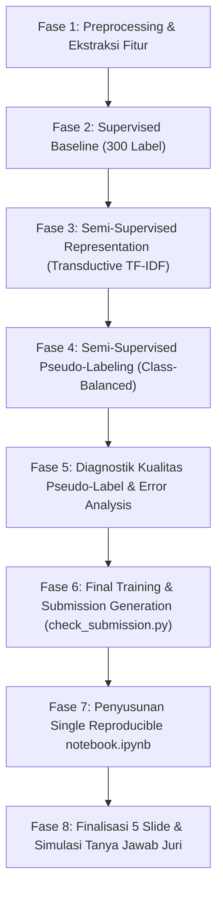

# 00. Master Plan: Proyek Semi-Supervised Sentiment Classification

> **Status:** Siap Dieksekusi oleh Junior Programmer / AI Implementer  
> **Target:** Menyelesaikan seluruh deliverable kompetisi GEMASTIK Penambangan Data (Notebook, Prediksi `submission.csv`, Presentasi 5 Slide, dan Pertahanan Juri) secara presisi, bebas error, dan berbasis bukti kuantitatif.

---

## 1. Ringkasan Eksekutif & Batasan Proyek

| Parameter | Spesifikasi |
|---|---|
| **Konteks Kompetisi** | Final Live Coding ML Penambangan Data GEMASTIK (Simulasi 60 Menit). |
| **Tema & Dampak** | *Cost-effective Innovation* berakar pada **SDG 8** (Decent Work & Economic Growth) dan **SDG 9** (Industry, Innovation & Infrastructure). |
| **Problem Statement** | Anggaran anotasi manual hanya cukup untuk **300 label**, sementara tersedia **10.633 data ulasan mentah tanpa label**. Pertanyaan inti: *Apakah data tanpa label benar-benar meningkatkan performa klasifikasi sentimen atau justru merugikan akibat noise & confirmation bias?* |
| **Metrik Evaluasi Utama** | **Macro-F1 Score** (Unweighted mean across `positive`, `negative`, `neutral`). |
| **Protokol Validasi** | **Stratified 5-Fold Cross-Validation** (Seed: 42) dengan split identik untuk semua eksperimen. |
| **Deliverables Akhir** | 1. `submission.csv` (1.246 baris, lolos `check_submission.py`).<br>2. `notebook.ipynb` (reproducible, naratif, komparasi baseline vs semi-supervised).<br>3. Kesimpulan maksimal 5 kalimat di akhir notebook.<br>4. 5 Slide Presentasi.<br>5. Lembar Pertahanan Tanya Jawab Juri. |

---

## 2. Navigasi Dokumen Perencanaan (`plans/`)

Folder `plans/` ini dirancang modular agar programmer/agen pelaksana dapat mengeksekusi setiap tahap secara mandiri tanpa ambigu:

```
plans/
├── 00_MASTER_PLAN.md                     <-- (Dokumen ini) Ringkasan eksekutif, peta jalan, SOP pelaksana
├── 01_SOLUSI_DAN_PEMILIHAN_MODEL.md      <-- Solusi teknis terbaik, rationale model, mitigasi confirmation bias
├── 02_TAHAPAN_IMPLEMENTASI_KODE.md       <-- Spesifikasi teknis implementasi kode per fase (Fase 1 - Fase 6)
└── 03_DELIVERABLES_NOTEBOOK_SLIDES.md    <-- Blueprint notebook, 5 slide presentasi, 5 kalimat kesimpulan, script juri
```

---

## 3. Peta Jalan Eksekusi (Phase-by-Phase Roadmap)



### Rincian Fase:
1. **Fase 1: Preprocessing & Transductive Vocabulary Adaptation**
   * Normalisasi teks Indonesia (slang, imbuhan, tanda baca berlebih).
   * Ekstraksi n-gram Word (1, 2) dan Character (3, 5).
   * Fit kosakata TF-IDF pada gabungan teks (Labeled + Unlabeled) untuk memangkas OOV Rate dari **70.49% ke 18.15%**.
2. **Fase 2: Supervised Baseline Benchmark**
   * Latih Linear Classifier: Logistic Regression, LinearSVC (Calibrated), Complement Naive Bayes (CNB), dan Blended Ensemble.
   * Catat skor Macro-F1 tiap fold (1-5) dan rata-rata ke [progress-tracker.md](file:///home/dicky/Downloads/G3_Semi_supervised/progress-tracker.md).
3. **Fase 3 & 4: Implementasi Semi-Supervised Learning**
   * Terapkan **Class-Balanced Adaptive Pseudo-Labeling (CB-PL)**.
   * Tetapkan threshold/kuota terpisah per kelas untuk melindungi kelas minoritas `neutral` dari kepunahan akibat *confirmation bias*.
   * Terapkan *sample weighting* ($w < 1.0$) untuk data pseudo-label.
4. **Fase 5: Diagnostik Pseudo-Label & Kejujuran Ilmiah**
   * Hitung berapa banyak pseudo-label tersaring dan distribusinya vs distribusi ground truth.
   * Analisis apakah semi-supervised meningkatkan atau menurunkan performa Macro-F1 pada CV.
5. **Fase 6: Inferensi & Verifikasi File Submission**
   * Latih model terbaik pada seluruh data latih + pseudo-label terpilih.
   * Prediksi 1.246 sampel pada `data/test.csv`.
   * Simpan `submission.csv` dan jalankan `python check_submission.py submission.csv`.
6. **Fase 7 & 8: Dokumentasi Notebook, 5 Slide, & Q&A Juri**
   * Satukan seluruh alur ke dalam `notebook.ipynb` yang dapat di-*run* bersih dari atas ke bawah.
   * Susun kesimpulan maksimal 5 kalimat.
   * Siapkan 5 slide presentasi dan contekan jawaban 3 pertanyaan juri.

---

## 4. Standar Operasional Prosedur (SOP) untuk Pelaksana / Junior Programmer

Bagi siapapun (programmer junior atau model AI berbiaya rendah) yang mengeksekusi rencana ini, wajib mematuhi aturan baku berikut:

1. **Gunakan Python Environment yang Tepat:**
   * Selalu gunakan virtual environment `.venv/bin/python` yang sudah berisi `pandas`, `scikit-learn`, `matplotlib`, `seaborn`, dan `ipykernel`.
2. **Aturan Mutlak Pencegahan Data Leakage:**
   * Dalam setiap fold validasi (Fold $k$), himpunan validasi ($val\_fold$) **TIDAK BOLEH** digunakan dalam pseudo-labeling, penentuan threshold, maupun fitting TF-IDF supervised.
   * Data tanpa label ($unlabeled.csv$) boleh di-fit untuk kosakata TF-IDF dan diprediksi untuk pseudo-labeling, tetapi $val\_fold$ harus tetap terisolasi sebagai penilai murni.
3. **Update Berkala di [progress-tracker.md](file:///home/dicky/Downloads/G3_Semi_supervised/progress-tracker.md):**
   * Setiap selesai mengeksekusi sebuah model/eksperimen, langsung isi skor Macro-F1 (Fold 1 - 5, Mean, Std) ke tabel log eksperimen.
4. **Verifikasi Wajib Sebelum Submit:**
   * Jangan pernah menganggap selesai sebelum menjalankan perintah:
     ```bash
     .venv/bin/python check_submission.py submission.csv
     ```
     dan menghasilkan output: `[OK] submission.csv valid (1246 baris)`.
5. **Prinsip Kejujuran Ilmiah GEMASTIK:**
   * Jika penambahan data pseudo-label ternyata menghasilkan kenaikan tipis atau bahkan sedikit penurunan, jangan manipulasi hasil! Dewan juri GEMASTIK sangat menghargai penalaran kritis mengapa data tanpa label dapat membawa *noise* atau *semantic drift*.
